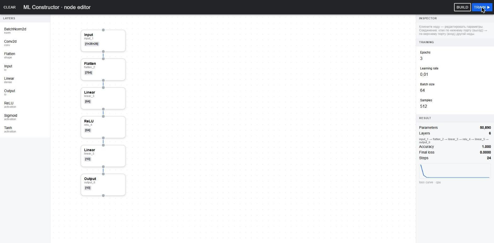

# ML Constructor

**English** · [Русский](README.ru.md)

A visual IDE for building neural networks — *"ComfyUI for neural nets"*. Drag
layer blocks onto a canvas, connect them into an architecture, press **Train**, and
a PyTorch backend assembles the graph into an `nn.Module`, trains it, and streams
the result back to the UI.

> **Status: v1 complete.** The whole pipeline works end-to-end — build a network in
> the visual node editor, press **Train**, and the PyTorch backend trains it and
> returns loss + accuracy, shown on the page. Proven live in the browser (see the
> [demo](#demo)). Next up: more layers, real datasets, GPU — see the [roadmap](#roadmap).

This is a standalone, self-hostable project. The whole pipeline runs locally from
the instructions below — no account, no cloud, no dataset download for the v1 demo.

## Demo



*The seeded example (Input → Flatten → Linear → ReLU → Linear → Output) after
**Build** (inferred shapes on every node, 50,890 parameters) and **Train**
(accuracy 1.000 on the synthetic demo task, loss → 0, loss curve) — all in the browser.*

---

## How it works

```
 ┌──────────────┐     graph spec (JSON)      ┌─────────────────────────────┐
 │  Node editor │  ───────────────────────▶  │  FastAPI backend (PyTorch)  │
 │ (Angular 22  │                            │                             │
 │  / Ionic 9)  │  ◀───────────────────────  │  spec → nn.Module → train   │
 └──────────────┘   summary / loss / acc     └─────────────────────────────┘
```

The core is deliberately OOP:

* **One class per layer** (`Input`, `Conv2d`, `Linear`, `ReLU`, `BatchNorm2d`,
  `Flatten`, …), each self-registering into a layer **registry**. Adding a layer
  is dropping a file in `backend/mlconstructor/layers/` — no central list to edit.
* **Shape inference runs before building**, so every connection is validated and
  dimensions are auto-filled (a `Linear` infers its `in_features` from upstream).
  Invalid graphs are rejected with a clear, node-pointed error instead of a deep
  torch crash — the seed of the planned "smart adapters".
* **Mother modules** compose layers: `NeuralNetwork` (the assembled graph) and
  `Block` (a reusable group you can repeat *N×*, à la "N× transformer blocks").
* The **node editor** is a lightweight custom SVG/Angular layer (no heavy graph
  dependency), driven entirely by Angular signals.

## Repository layout

```
05-ml-constructor/
├─ backend/                     Python: FastAPI + PyTorch
│  ├─ mlconstructor/
│  │  ├─ layers/                one class per layer (self-registering)
│  │  ├─ registry.py           the layer catalogue
│  │  ├─ assembly.py           shape propagation + module build (shared)
│  │  ├─ blocks.py             NeuralNetwork, Block (repeatable)
│  │  ├─ builder.py            graph spec → NeuralNetwork
│  │  ├─ trainer.py            tiny synthetic-data training loop
│  │  ├─ projects.py           project files: format, migrations, server store
│  │  └─ schema.py             the UI⇄backend contract (pydantic)
│  ├─ app.py                   FastAPI entry point
│  ├─ tests/test_end_to_end.py the M1 proof
│  └─ requirements.txt
└─ frontend/                    Angular 22 + Ionic 9 node editor
   └─ src/app/
      ├─ editor/                the node-editor page (canvas, palette, inspector)
      └─ core/                  api.service.ts, graph.models.ts (contract mirror),
                                project.ts (save / open / autosave)
```

## Quickstart — backend

Requires **Python 3.12**.

```bash
cd backend
python -m venv .venv
#   Windows (PowerShell):  .venv\Scripts\Activate.ps1
#   Linux / macOS:         source .venv/bin/activate

pip install fastapi "uvicorn[standard]" pydantic numpy
pip install torch --index-url https://download.pytorch.org/whl/cpu
#   CUDA build instead: --index-url https://download.pytorch.org/whl/cu126
#   (GPU training is optional: pick Device -> GPU in the editor; the default is the CPU)

python tests/test_end_to_end.py           # prove the pipeline (build + train)
python -m uvicorn app:app --port 8050     # run the API
```

## Quickstart — frontend

Requires **Node 18+** (developed on Node 24) and the backend running (above).

```bash
cd frontend
npm install
npm start          # dev server on http://localhost:4200 (calls the backend on :8050, CORS open)
```

Or a production build served as static files:

```bash
npm run build      # outputs dist/mlconstructor/browser
npx http-server dist/mlconstructor/browser -p 4200
#   (or: python -m http.server 4200 -d dist/mlconstructor/browser)
```

Open **http://localhost:4200** — the editor loads with an example MLP. Press
**Build** to see inferred shapes and parameter counts, then **Train ▶** to train it
and watch the loss curve. On Windows, `run-dev.ps1` in the repo root launches the
backend and the built frontend together.

## The graph spec

A model is a JSON graph of `nodes` + directed `edges` + a `train` block:

```jsonc
{
  "nodes": [
    { "id": "in",   "type": "Input",   "params": { "shape": [1, 28, 28] } },
    { "id": "conv", "type": "Conv2d",  "params": { "out_channels": 8, "kernel_size": 3 } },
    { "id": "act",  "type": "ReLU",    "params": {} },
    { "id": "flat", "type": "Flatten", "params": {} },
    { "id": "fc",   "type": "Linear",  "params": { "out_features": 10 } },
    { "id": "out",  "type": "Output",  "params": {} }
  ],
  "edges": [ ["in","conv"], ["conv","act"], ["act","flat"], ["flat","fc"], ["fc","out"] ],
  "train": { "dataset": "synthetic", "epochs": 1, "lr": 0.01, "batch_size": 64 }
}
```

* `POST /build` → per-layer shapes + parameter counts (or a `422` with the reason).
* `POST /train` → `{ loss_curve, final_loss, final_accuracy, final_val_accuracy, fit, steps, ... }`.
* `train.val_fraction` (default `0.2`) → the share of rows held out for validation: the
  network never trains on them, so `final_val_accuracy` / `val_acc_curve` show how it
  does on new data and `fit` gives a plain-words verdict (`0` = train and measure on
  every row).
* `train.test_fraction` (default `0.1`) → rows kept for a final test; `POST /test`
  (`{spec, run_id}`) measures a run's weights on them and says whether that is a fair
  check. The same `seed` gives the same numbers: it sets the starting weights too.
* Every training run keeps its weights (`run_id` in the result): `GET /runs/{run_id}/weights`
  downloads them (`.pt`), `POST /weights/upload` loads a file back (read with
  `weights_only=True`, tensors only), `train.init_run` trains on from them, and the
  exported `model.py` has `load_weights()`.
* `GET /layers` → the palette the editor renders.
* `edge_settings` (optional) → how a connection reshapes its data; without it every
  connection adapts by itself (flatten, fold into an image, read an image as a
  sequence, …). `POST /connections/options` lists the choices for one connection.

> **v1 scope:** a single linear chain (one `Input` → one `Output`). Branch/merge
> nodes (Add, Concat, residuals) and real datasets are planned — see below.

## Projects (`.mlc.json`)

Your work is kept: the editor autosaves a draft in the browser and brings it back after
a reload. **Save** (Ctrl+S) keeps a project in the browser, **Download** writes a
`.mlc.json` file that opens on any ML Constructor (pick it, or drop it onto the
canvas), and a self-hosted instance can keep projects on the server too. A project
file holds the graph with node positions, the training setup (pasted rows included)
and a format version — older files, and a bare graph spec like the one above, are
upgraded when opened.

* `POST /projects/normalize` → any supported file version → the current format + warnings.
* `GET /projects`, `POST /projects`, `GET | PUT | DELETE /projects/{name}` → the optional
  server store (`MLC_SERVER_PROJECTS=0` switches it off, `MLC_PROJECTS_DIR` moves it).

## Roadmap

**v1 — end-to-end thin slice** *(complete)*

* **M1 — backend core** ✓: layer classes + registry, graph→`nn.Module` builder,
  FastAPI (`/health`, `/layers`, `/build`, `/train`), proven by the test.
* **M2 — node editor** ✓: Angular/Ionic canvas, palette from `/layers`, add nodes,
  connect, edit params, Build/Train.
* **M3 — wired up** ✓: build a net in the browser → train → see the result.

**Beyond v1**

* Full layer families (CNN, RNN/LSTM, Transformer/attention, norm variants) with
  automatic shape/type adaptation on connections ("smart adapters").
* A library of ready public architectures (ResNet, GPT-style LLMs, …), deeply editable.
* Fine-grained control: custom blocks with repeat counts, per-layer settings.
* Real datasets and GPU training; migrate the editor to a richer engine
  (e.g. `@comfyorg/litegraph`) as it grows.

## License

A non-commercial source-available license — **PolyForm Noncommercial 1.0.0**
(see [LICENSE](LICENSE)). A non-commercial restriction makes this *source-available*,
not OSI-"open source".

**Commercial use?** A commercial license for one organization is available:
https://whop.com/chaboss/ml-constructor-commercial-license

## Links

Part of a small network of experiments. Project channels (YouTube / Telegram) and
the GitHub repository will be linked here once published. Russian version:
[README.ru.md](README.ru.md).
