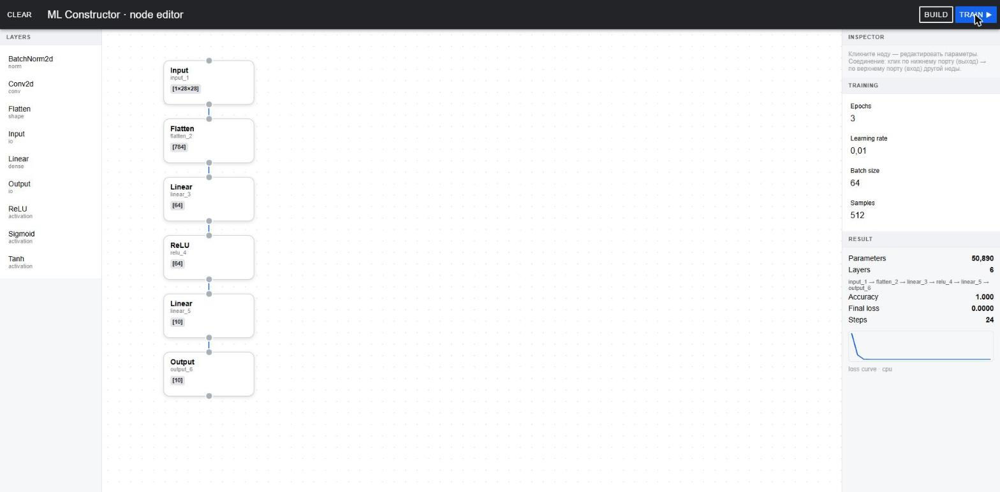

# ML Constructor

[English](README.md) · **Русский**

Визуальная IDE для сборки нейросетей — «ComfyUI для нейросетей». Перетаскивайте
блоки-слои на холст, соединяйте их в архитектуру, жмите **Train** — и бэкенд на
PyTorch собирает граф в `nn.Module`, обучает его и возвращает результат в интерфейс.

> **Статус: v1 готов.** Весь конвейер работает от начала до конца — соберите сеть в
> визуальном нода-редакторе, нажмите **Train**, и PyTorch-бэкенд обучит её и вернёт
> loss и accuracy прямо на страницу. Доказано вживую в браузере (см. [демо](#демо)).
> Дальше — больше слоёв, реальные датасеты, GPU (см. [дорожную карту](#дорожная-карта)).

Это самостоятельный, self-hosted проект. Весь конвейер запускается локально по
инструкции ниже — без аккаунта, без облака, без скачивания датасетов для демо v1.

## Демо



*Пример-граф (Input → Flatten → Linear → ReLU → Linear → Output) после **Build**
(выведенные формы на каждой ноде, 50 890 параметров) и **Train** (accuracy 1.000 на
синтетических демо-данных, loss → 0, кривая loss) — всё в браузере.*

---

## Как это устроено

```
 ┌──────────────┐    спецификация графа      ┌─────────────────────────────┐
 │ Нода-редактор│  ───────────────────────▶  │  FastAPI-бэкенд (PyTorch)   │
 │ (Angular 22  │                            │                             │
 │  / Ionic 9)  │  ◀───────────────────────  │  спека → nn.Module → обуч.  │
 └──────────────┘   summary / loss / acc     └─────────────────────────────┘
```

Ядро нарочно ООП-ное:

* **Класс на каждый слой** (`Input`, `Conv2d`, `Linear`, `ReLU`, `BatchNorm2d`,
  `Flatten`, …), каждый сам регистрируется в реестре слоёв. Добавить слой — положить
  файл в `backend/mlconstructor/layers/`, без правки центрального списка.
* **Вывод форм — до сборки**: каждое соединение валидируется, размерности
  подставляются автоматически (`Linear` берёт `in_features` из входа). Неверный граф
  отклоняется понятной ошибкой с id ноды, а не падением в недрах torch — это семя
  будущих «умных адаптеров».
* **Материнские модули** собирают слои: `NeuralNetwork` (весь граф) и `Block`
  (переиспользуемая группа с повтором *N×*, как «N× трансформерных блоков»).
* **Нода-редактор** — лёгкий кастомный SVG/Angular-слой (без тяжёлой граф-зависимости),
  целиком на сигналах Angular.

## Структура репозитория

```
05-ml-constructor/
├─ backend/                     Python: FastAPI + PyTorch
│  ├─ mlconstructor/
│  │  ├─ layers/                класс на каждый слой (само-регистрация)
│  │  ├─ registry.py           каталог слоёв
│  │  ├─ assembly.py           вывод форм + сборка модулей (общее)
│  │  ├─ blocks.py             NeuralNetwork, Block (с повтором)
│  │  ├─ builder.py            граф → NeuralNetwork
│  │  ├─ trainer.py            крошечный цикл обучения на синтетике
│  │  └─ schema.py             контракт UI⇄бэкенд (pydantic)
│  ├─ app.py                   точка входа FastAPI
│  ├─ tests/test_end_to_end.py доказательство M1
│  └─ requirements.txt
└─ frontend/                    нода-редактор Angular 22 + Ionic 9
   └─ src/app/
      ├─ editor/                страница редактора (холст, палитра, инспектор)
      └─ core/                  api.service.ts, graph.models.ts (зеркало контракта)
```

## Быстрый старт — бэкенд

Требуется **Python 3.12**.

```bash
cd backend
python -m venv .venv
#   Windows (PowerShell):  .venv\Scripts\Activate.ps1
#   Linux / macOS:         source .venv/bin/activate

pip install fastapi "uvicorn[standard]" pydantic numpy
pip install torch --index-url https://download.pytorch.org/whl/cpu
#   сборка под CUDA:     --index-url https://download.pytorch.org/whl/cu126
#   (обучение на GPU — по желанию: Device -> GPU в редакторе; по умолчанию CPU)

python tests/test_end_to_end.py           # доказать конвейер (build + train)
python -m uvicorn app:app --port 8050     # запустить API
```

## Быстрый старт — фронтенд

Требуется **Node 18+** (разрабатывалось на Node 24) и запущенный бэкенд (выше).

```bash
cd frontend
npm install
npm start          # dev-сервер на http://localhost:4200 (ходит в бэкенд на :8050, CORS открыт)
```

Либо продакшн-сборка, отдаваемая как статика:

```bash
npm run build      # результат в dist/mlconstructor/browser
npx http-server dist/mlconstructor/browser -p 4200
#   (или: python -m http.server 4200 -d dist/mlconstructor/browser)
```

Откройте **http://localhost:4200** — редактор откроется с примером-MLP. Нажмите
**Build**, чтобы увидеть выведенные формы и число параметров, затем **Train ▶**, чтобы
обучить и посмотреть кривую loss. На Windows скрипт `run-dev.ps1` в корне запускает
бэкенд и собранный фронт вместе.

## Спецификация графа

Модель — это JSON-граф из `nodes` + направленных `edges` + блока `train`:

```jsonc
{
  "nodes": [
    { "id": "in",   "type": "Input",   "params": { "shape": [1, 28, 28] } },
    { "id": "conv", "type": "Conv2d",  "params": { "out_channels": 8, "kernel_size": 3 } },
    { "id": "act",  "type": "ReLU",    "params": {} },
    { "id": "flat", "type": "Flatten", "params": {} },
    { "id": "fc",   "type": "Linear",  "params": { "out_features": 10 } },
    { "id": "out",  "type": "Output",  "params": {} }
  ],
  "edges": [ ["in","conv"], ["conv","act"], ["act","flat"], ["flat","fc"], ["fc","out"] ],
  "train": { "dataset": "synthetic", "epochs": 1, "lr": 0.01, "batch_size": 64 }
}
```

* `POST /build` → формы и число параметров по слоям (или `422` с причиной).
* `POST /train` → `{ loss_curve, final_loss, final_accuracy, steps, ... }`.
* `GET /layers` → палитра, из которой рисуется редактор.

> **Рамки v1:** одна линейная цепочка (один `Input` → один `Output`). Узлы с
> ветвлением/слиянием (Add, Concat, residual) и реальные датасеты — в планах, см. ниже.

## Дорожная карта

**v1 — сквозной тонкий срез** *(готово)*

* **M1 — ядро бэкенда** ✓: классы слоёв + реестр, builder граф→`nn.Module`,
  FastAPI (`/health`, `/layers`, `/build`, `/train`), доказано тестом.
* **M2 — нода-редактор** ✓: холст Angular/Ionic, палитра из `/layers`, добавление нод,
  соединения, правка параметров, Build/Train.
* **M3 — связано** ✓: собрал сеть в браузере → обучил → увидел результат.

**За пределами v1**

* Полные семейства слоёв (CNN, RNN/LSTM, трансформеры/attention, варианты
  нормализации) с автоматическим согласованием форм/типов на соединениях («умные
  адаптеры»).
* Библиотека готовых публичных архитектур (ResNet, GPT-подобные LLM, …) с глубоким
  редактированием.
* Тонкая настройка: кастомные блоки с повторами, параметры на уровне слоя.
* Реальные датасеты и обучение на GPU; миграция редактора на более богатый движок
  (например, `@comfyorg/litegraph`) по мере роста.

## Лицензия

Некоммерческая source-available лицензия — **PolyForm Noncommercial 1.0.0**
(см. [LICENSE](LICENSE)). Запрет на коммерческое использование делает проект технически
*source-available*, а не строго OSI-«open source».

**Нужно коммерческое использование?** Доступна коммерческая лицензия для одной организации:
https://whop.com/chaboss/ml-constructor-commercial-license

## Ссылки

Часть небольшой сетки экспериментов. Каналы проекта (YouTube / Telegram) и репозиторий
на GitHub появятся здесь после публикации.
